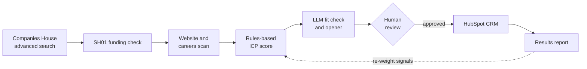

# GTM Outbound Engine

**A signal-based prospecting pipeline that finds UK tech startups that have just raised money and are building a sales team.**

Most outbound lists are built from static filters like industry and headcount. This pipeline looks for *timing* instead: a company that has just issued new shares and is hiring its first sales reps needs pipeline now.

## The idea

When a UK company issues new shares it must file an **SH01** with Companies House. For a startup, a fresh SH01 usually means a funding round, and the filing is public, often before any announcement. Combining that with hiring signals from the company's own website gives a short list of accounts worth contacting this month.



## How it works

| Step | Script | What it does |
|---|---|---|
| 1 | `1_pull_companies.py` | Searches active UK tech companies by SIC code, then checks each one's filing history for SH01 filings in the past 12 months. Handles rate limits, retries dropped connections and saves as it goes. |
| 2 | `2_detect_signals.py` | Reads each company's homepage, careers page and linked job boards. Scores every account with a transparent rules model: every point has a written reason. |
| 3 | `3_ai_personalise.py` | Asks an LLM to assess fit and draft an opening line grounded only in the evidence collected. Falls back to templates without an API key. |
| 4 | `4_sync_hubspot.py` | Pushes human-approved accounts to HubSpot with custom fields for score, signals and opener. Dry run by default. |
| 5 | `5_results_report.py` | Breaks reply rates down by signal, score band and LLM fit rating, to show which signals actually predict interest. |

All targeting lives in `config.py`: SIC codes, signal keywords, weights and the qualification threshold. Pointing the engine at a different market means editing that one file.

### Signals

| Signal | Source | Points |
|---|---|---|
| Shares allotted in last 90 / 180 / 365 days | Companies House | +35 / +25 / +10 |
| Two or more allotments in 12 months | Companies House | +10 |
| Hiring SDRs, BDRs or account executives | Website | +25 |
| Hiring a sales leader | Website | +20 |
| Demo-led sales motion | Website | +10 |
| Founder-led sales | Website | +10 |
| **Already has GTM engineering or RevOps** | Website | **−50** |

An account qualifies only if it scores 50 or more **and** shows at least one positive website signal.

## Results so far

First live run, October 2026:

| Stage | Count |
|---|---|
| Companies scanned | 600 |
| With a share allotment in the past 12 months | 15 |
| Verified by hand as real, funded startups | ~5 |
| Qualified by the scoring model | 2 |

**What I learned**

- **A share filing alone is a noisy signal.** Only about a third of flagged companies were real funded startups. The rest were consultancies and holding companies topping up founder shares.
- **Funding alone should never qualify an account.** One company scored 50 purely on filings, with no website at all. I changed the rule to require an independent second signal.
- **Negative signals matter.** A company already hiring a GTM engineer is a poor target however good its other signals are.
- **Simple scrapers miss JavaScript-rendered sites.** Hiring signals are under-detected; a jobs API is the next improvement.

The two accounts the model qualified were the same two I would have picked by hand.

## Status

| Component | State |
|---|---|
| Companies House pull and SH01 detection | Running on live data |
| Website signal scan and scoring | Running on live data |
| LLM personalisation | Built, tested in template mode |
| HubSpot sync | Built, tested as a dry run |
| Outreach and results | In progress |

## Quick start

No API keys needed for the demo, which uses eight fictional companies.

```bash
pip install -r requirements.txt
python 1_pull_companies.py --demo
python 2_detect_signals.py --demo
python 3_ai_personalise.py
python 4_sync_hubspot.py
```

On Windows, use `py` instead of `python`.

### Running on live data

Copy `.env.example`, fill in your keys and set them as environment variables. Keys are never stored in the code.

```bash
export COMPANIES_HOUSE_API_KEY="..."     # free: developer.company-information.service.gov.uk
python 1_pull_companies.py --scan 3000
```

Companies House does not hold websites, so add them to the `website` column of `data/companies.csv` before step 2. Then:

```bash
python 2_detect_signals.py
export ANTHROPIC_API_KEY="..."
python 3_ai_personalise.py               # then review data/personalised.csv and set approved=yes/no
export HUBSPOT_TOKEN="..."
python 4_sync_hubspot.py --send
python 5_results_report.py
```

## Responsible use

- Uses only public Companies House data and public web pages, within the published API rate limits.
- The scraper reads a handful of pages per site and pauses between requests.
- The LLM is told never to state a funding amount or investor, because an SH01 does not prove either.
- Nothing reaches the CRM without human approval.
- Outreach follows UK PECR and GDPR guidance for business-to-business email: relevant to the recipient's role, clearly identified and easy to opt out of.

## Roadmap

- [ ] Jobs API for hiring signals, replacing careers-page scraping
- [ ] Automatic website lookup
- [ ] Weekly scheduled run that alerts only on new filings
- [ ] Re-weight signal points from reply data with logistic regression

## Built with

Python, Companies House REST API, BeautifulSoup, Anthropic API, HubSpot CRM API. Built with AI assistance.
